# 作业一：多数据库文献检索策略初稿

> 使用说明：本文已经完成研究问题、PICOS、检索词和五个数据库的检索策略设计。所有标有“【待填写】”或“【待截图】”的内容，都需要在数据库网页中实际操作后补充，不能凭空填写。

## 1. 学术诚信与生成式 AI 声明

提交时必须附上学校指定格式、由本人签名的《生成式人工智能使用声明》。本作业使用生成式 AI 的实际情况可以如实表述为：生成式 AI 用于解释作业要求、协助构建初步检索词和检索式、改进语言表达；所有数据库检索、结果核对、文献筛选和最终内容均由学生本人复核。

【待完成】下载并填写学校要求的正式声明表，签名后与作业一起提交。不要用上面这段话代替学校的正式表格。

## 2. 作业题目

人工智能驱动的对话代理在支持 2 型糖尿病成人患者自我管理和改善血糖控制方面的有效性：针对随机对照试验的多数据库检索

英文题目：The Effectiveness of Artificial Intelligence-Powered Conversational Agents in Supporting Self-Management and Improving Glycemic Control Among Adults With Type 2 Diabetes: A Multi-Database Search for Randomized Controlled Trials

## 3. 临床护理问题

对于成年 2 型糖尿病患者，与常规护理、常规糖尿病教育或未使用人工智能对话工具相比，使用人工智能驱动的对话代理是否能够改善患者的自我管理和血糖控制？

## 4. PICOS 框架

### 4.1 P：研究对象（Population）

成年 2 型糖尿病患者。

纳入范围：年龄达到研究所定义的成年人标准，并被诊断为 2 型糖尿病的患者。

排除范围：仅研究 1 型糖尿病、妊娠糖尿病、儿童或青少年的研究；如果研究包含混合人群，但能够单独提取成年 2 型糖尿病患者的数据，可以考虑纳入。

### 4.2 I：干预措施（Intervention）

人工智能驱动的对话代理，包括聊天机器人、虚拟健康助手、具身对话代理、语音助手及其他能够与患者进行自动对话的人工智能系统。干预可以提供糖尿病教育、个性化反馈、提醒、行为支持或用药管理协助。

### 4.3 C：比较措施（Comparator）

常规护理、常规糖尿病教育、等待名单、未使用人工智能对话工具，或其他非对话式数字健康干预。

说明：原作业没有把比较措施限定为唯一类型，因此最终应以每项随机对照试验实际采用的对照条件为准。比较措施一般不放入敏感性检索式，以免遗漏文献。

### 4.4 O：结局指标（Outcomes）

主要结局包括：

- 血糖控制，例如糖化血红蛋白（HbA1c）和血糖水平。
- 糖尿病自我管理，例如血糖监测、合理用药、饮食管理和身体活动。

可以记录的其他相关结局包括服药依从性、自我效能和糖尿病相关行为改变，但是否纳入应以研究是否直接反映自我管理为判断依据。

### 4.5 S：研究设计（Study design）

随机对照试验（randomized controlled trial, RCT）。已发表的正式试验结果是主要目标；仅有研究方案而没有试验结果的 protocol 通常不作为最终有效性证据，但可以在初筛阶段单独标记。

## 5. 检索概念与检索词

### 5.1 概念一：2 型糖尿病

英文受控词：Diabetes Mellitus, Type 2

英文自由词：type 2 diabetes、type 2 diabetes mellitus、type II diabetes、type II diabetes mellitus、T2DM、NIDDM

中文自由词：2 型糖尿病、Ⅱ型糖尿病、II 型糖尿病、T2DM、非胰岛素依赖型糖尿病

### 5.2 概念二：人工智能对话代理

英文受控词或相关主题词：Artificial Intelligence、Natural Language Processing、Intelligent Systems、Generative Artificial Intelligence

英文自由词：chatbot、conversational agent、conversational AI、virtual health assistant、virtual assistant、voice assistant、embodied conversational agent、dialogue system、dialog system、voice-based AI

中文自由词：人工智能、对话代理、会话代理、聊天机器人、虚拟健康助手、虚拟助手、语音助手、智能语音、人机对话

说明：2026 年 MeSH 将 Chatbot 作为 Generative Artificial Intelligence 的入口词，但较早期的糖尿病聊天机器人不一定属于生成式 AI，因此不能只依赖这个新主题词，必须同时检索 Artificial Intelligence 和自由文本词。

### 5.3 概念三：自我管理与血糖控制

英文受控词：Self-Management、Self Care、Blood Glucose、Glycated Hemoglobin

英文自由词：self-management、self care、glycemic control、glycaemic control、blood glucose、HbA1c、A1c

中文自由词：自我管理、自我护理、血糖控制、血糖、糖化血红蛋白、HbA1c、用药依从性

### 5.4 概念四：随机对照试验

英文检索词：randomized controlled trial、controlled clinical trial、randomized、randomised、randomly、trial

中文检索词：随机对照试验、随机对照、随机、对照试验、临床试验

## 6. 敏感性检索与特异性检索的设计

敏感性检索采用“研究对象 AND 干预措施”。这种方式不强制加入结局和研究设计，可以尽可能找全相关研究，但会产生较多无关结果。

特异性检索采用“研究对象 AND 明确的对话代理词 AND 结局指标 AND 随机试验词”。这种方式可以显著减少无关结果，但可能漏掉尚未完成主题标引、摘要中没有写明结局或研究设计的文献。

不建议把比较措施加入检索式，因为对照条件的表达非常多样，加入后容易漏检。

## 7. 各数据库检索策略

### 7.1 PubMed

数据库：PubMed

平台：U.S. National Library of Medicine（NLM）

实际检索日期：【待填写】

#### 7.1.1 敏感性检索式

为了完整展示检索策略的形成过程，应在 PubMed 的 Advanced Search 中逐条运行，而不是一次粘贴最终组合式。

开始前的操作：

1. 打开 PubMed 首页，点击搜索框下方的 `Advanced`。
2. 检查页面是否显示绿色的 `Filters applied`。如果以前使用过过滤器，先点击 `Clear filters`，因为敏感性检索暂时不限制年龄、语言、年份和研究类型。
3. 在 Advanced Search 的 Query box 中输入检索词。
4. 将按钮从 `Search` 切换为 `Add to History`。以后每输入一步都点击 `Add to History`，这样运行检索后仍停留在当前页面，并在下方 History 中显示编号、检索式、结果数和时间。
5. 以下步骤假设 History 从 #1 开始。如果你的页面已有历史记录，系统编号可能不同，组合时必须使用页面实际显示的编号。

第 1 步：检索 2 型糖尿病的 MeSH 主题词。复制以下内容到 Query box，点击 `Add to History`：

```text
"Diabetes Mellitus, Type 2"[Mesh]
```
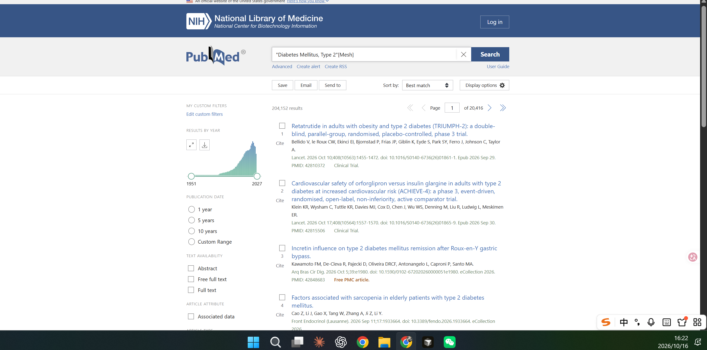

History 中应生成 #1。记录其结果数。

第 2 步：删除 Query box 中原有内容，粘贴 2 型糖尿病的自由文本词，然后点击 `Add to History`：

```text
"type 2 diabetes"[tiab] OR "type 2 diabetes mellitus"[tiab] OR "type II diabetes"[tiab] OR "type II diabetes mellitus"[tiab] OR T2DM[tiab] OR NIDDM[tiab]
```
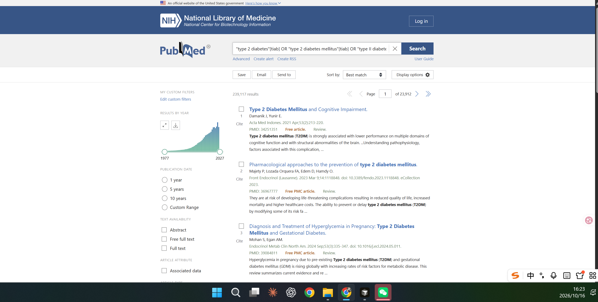

History 中应生成 #2。

第 3 步：合并糖尿病主题词与自由词。在 Query box 输入以下内容并点击 `Add to History`：

```text
#1 OR #2
```
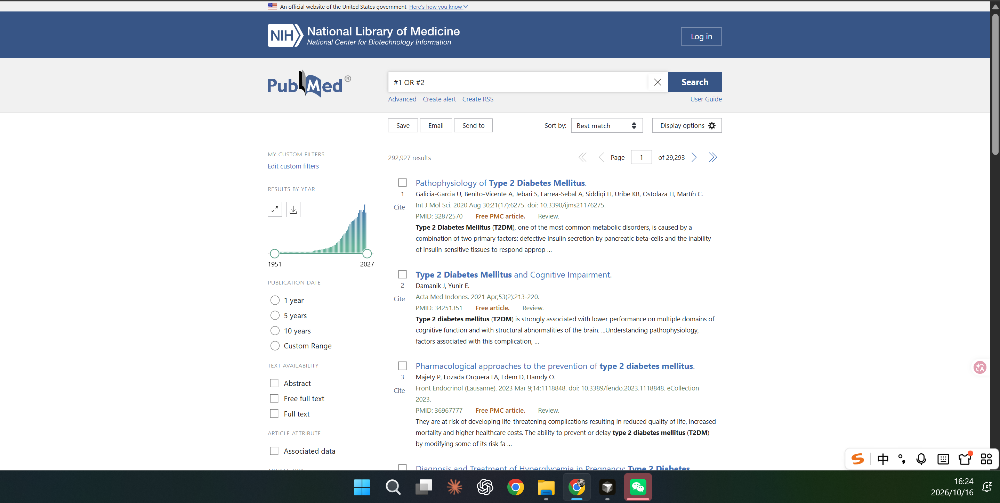

History 中应生成 #3。#3 就是完整的“2 型糖尿病”概念组。

第 4 步：检索 Artificial Intelligence 主题词：

```text
"Artificial Intelligence"[Mesh]
```
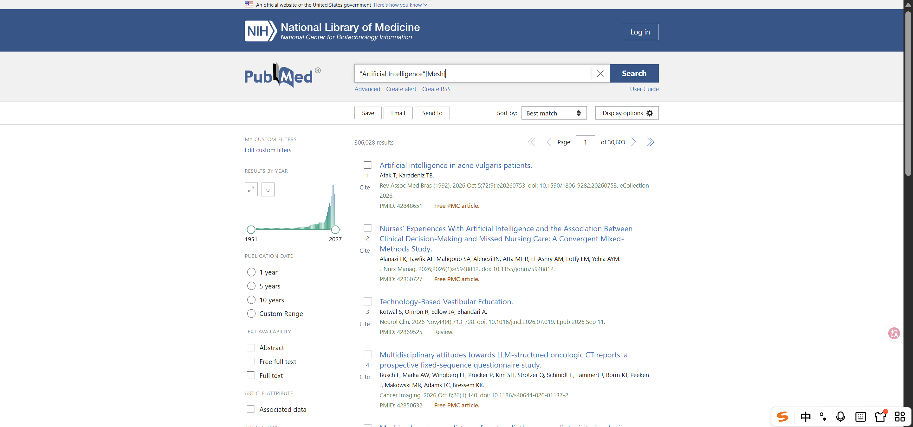

点击 `Add to History`，生成 #4。

第 5 步：检索 Natural Language Processing 主题词：

```text
"Natural Language Processing"[Mesh]
```
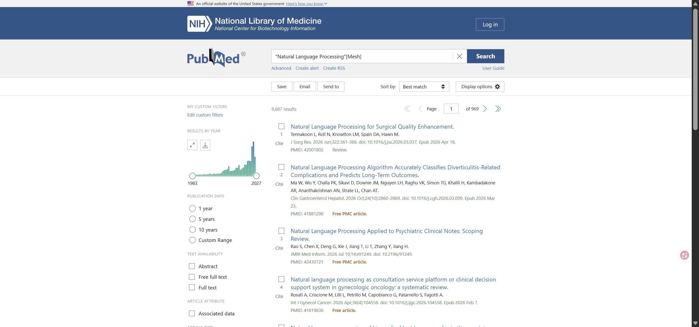

点击 `Add to History`，生成 #5。

第 6 步：检索 Intelligent Systems 主题词：

```text
"Intelligent Systems"[Mesh]
```
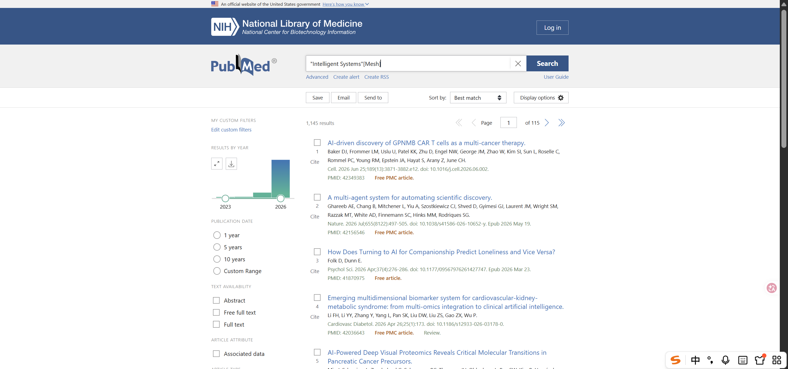

点击 `Add to History`，生成 #6。

第 7 步：检索 Generative Artificial Intelligence 主题词：

```text
"Generative Artificial Intelligence"[Mesh]
```
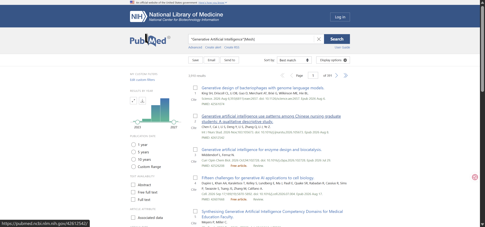

点击 `Add to History`，生成 #7。

第 8 步：检索人工智能对话代理的自由文本词。复制以下内容并点击 `Add to History`：

```text
chatbot*[tiab] OR "conversational agent"[tiab] OR "conversational agents"[tiab] OR "conversational AI"[tiab] OR "virtual health assistant"[tiab] OR "virtual health assistants"[tiab] OR "virtual assistant"[tiab] OR "virtual assistants"[tiab] OR "voice assistant"[tiab] OR "voice assistants"[tiab] OR "embodied conversational agent"[tiab] OR "embodied conversational agents"[tiab] OR "dialogue system"[tiab] OR "dialogue systems"[tiab] OR "dialog system"[tiab] OR "dialog systems"[tiab] OR "voice-based AI"[tiab]
```
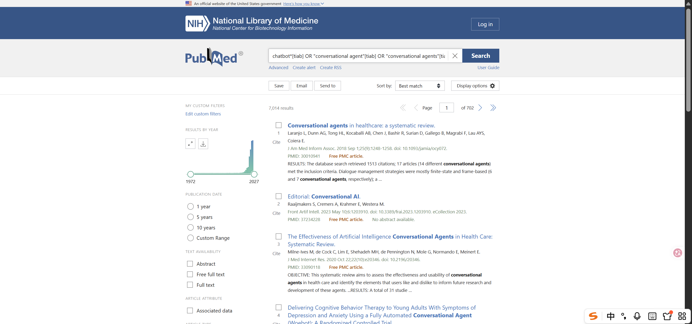

History 中应生成 #8。

第 9 步：合并人工智能主题词与对话代理自由词：

```text
#4 OR #5 OR #6 OR #7 OR #8
```
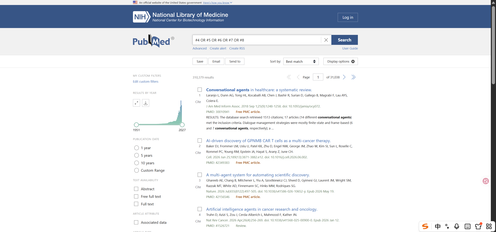

点击 `Add to History`，生成 #9。#9 就是完整的“人工智能对话代理”概念组。

第 10 步：将研究对象与干预措施相交：

```text
#3 AND #9
```
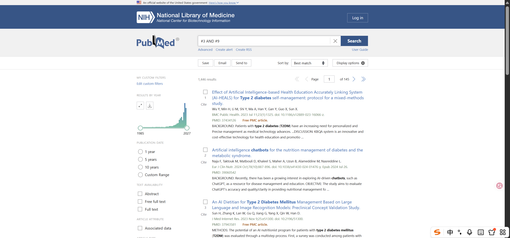

点击 `Add to History`，生成 #10。#10 是最终敏感性检索结果，应将 #10 的结果数填写到“最终结果数”。

完成后，在 History 中点击 #10 左侧或旁边的展开箭头 `>`，打开 Search Details，检查是否存在红色警告。点击 #10 的结果数可以打开最终文献列表。建议保存三类证据：显示 #1-#10 的 History 截图、展开后的 #10 Search Details 截图，以及显示最终结果数且没有启用过滤器的结果页面截图。还可以点击 History 中的 `Download` 保存 CSV 作为备份。


History and Search Details：C:\work\MPU\8123-metaAnalysis\Work\searchDetails\PubMedSearchHistory.csv

限制条件：不限制发表年份和语言。为了保持敏感性，第一轮不使用年龄和研究类型过滤器。

开发验证结果：2026-10-16 通过 PubMed 官方 API 验证时返回 1,446 条。该数字仅用于证明检索式可运行，不可代替最终网页检索结果和截图。

最终结果数：【待填写】

潜在相关研究数：【阅读题目和摘要后填写】

截图：【待截图。需同时显示完整检索式或检索历史、结果数和日期】

#### 7.1.2 特异性检索式

特异性检索可以接着同一个 History 继续构建。#3 和 #8 直接复用前面已经建立的研究对象组和对话代理自由词组。

```text
#11 "Self-Management"[Mesh] OR "Self Care"[Mesh] OR "Blood Glucose"[Mesh] OR "Glycated Hemoglobin"[Mesh]

#12 self-manag*[tiab] OR self-care[tiab] OR "self care"[tiab] OR "glycemic control"[tiab] OR "glycaemic control"[tiab] OR "blood glucose"[tiab] OR HbA1c[tiab] OR A1c[tiab]

#13 #11 OR #12

#14 "randomized controlled trial"[pt] OR "controlled clinical trial"[pt]

#15 random*[tiab] OR trial[tiab]

#16 #14 OR #15

#17 #3 AND #8 AND #13 AND #16

#18 #17 AND humans[Mesh] AND adult[Mesh]
```

步骤含义：#11 是结局主题词，#12 是结局自由词，#13 将两者合并；#14 是随机对照试验的出版类型，#15 是随机试验自由词，#16 将两者合并；#17 形成未加人群限制的特异性检索，#18 再限定为人类和成年人研究，作为最终的特异性结果。

限制条件：Humans；Adult: 19+；不限制发表年份和语言。

#11
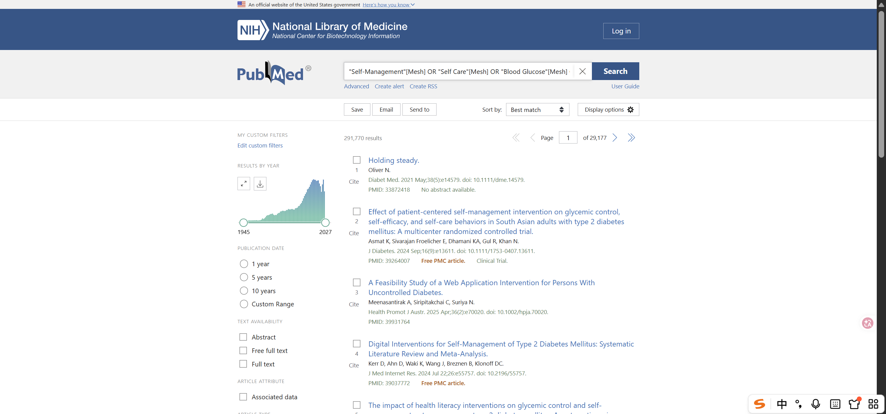

#12
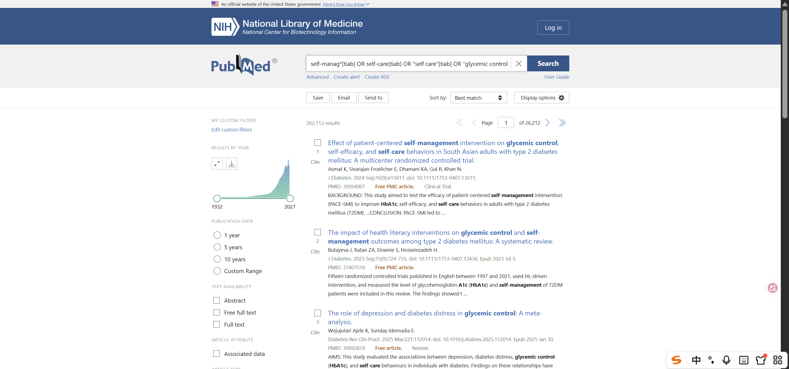

#13
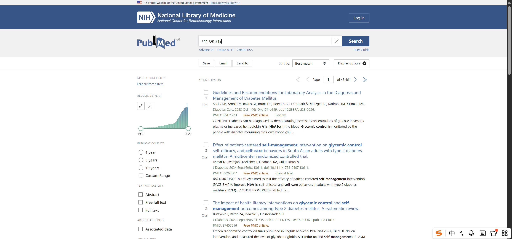

#14
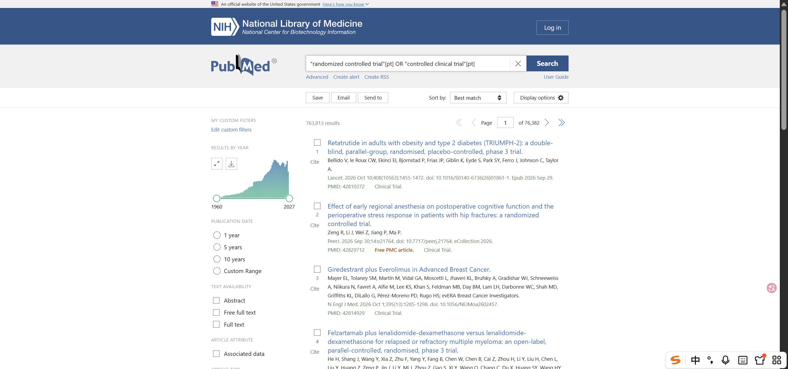

#15
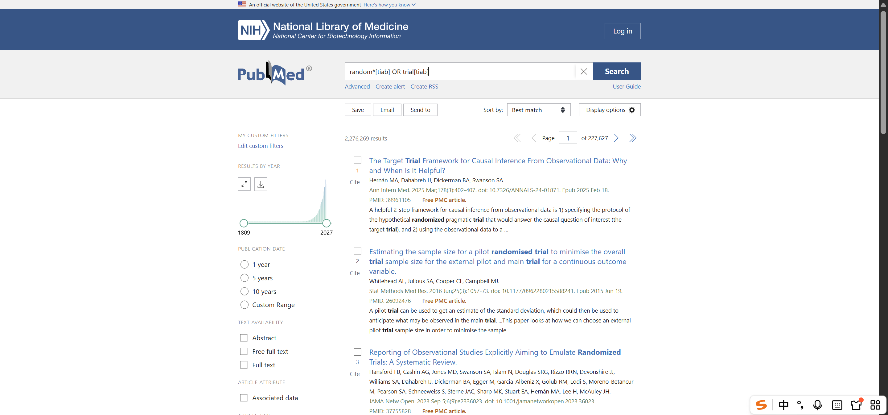

#16
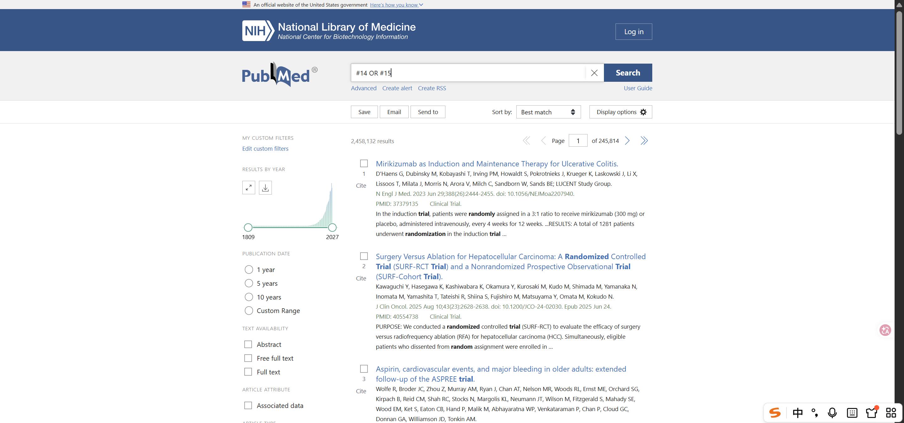

#17
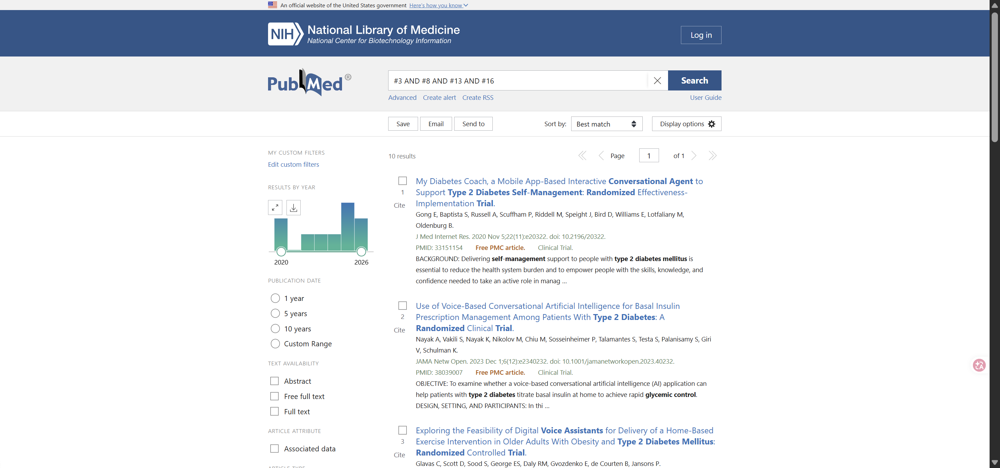

#18
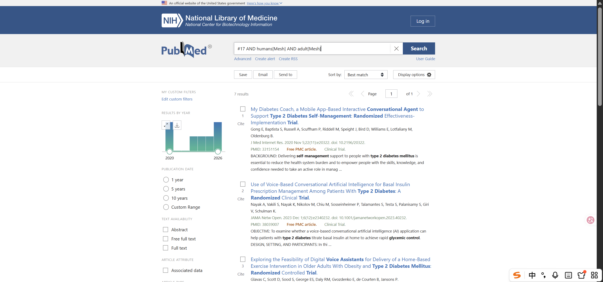

History and Search Details：


开发验证结果：2026-10-16 通过 PubMed 官方 API 验证时返回 7 条。最终应在 PubMed 网页中重新运行并截图，因为结果数会变化。

最终结果数：【待填写】

潜在相关研究数：【待填写】

截图：【待截图】

操作提示：进入 PubMed 的 Advanced Search，从 #1 开始逐条复制“编号后面的检索内容”并运行。不要把“#1”与检索内容一起粘贴；#3、#9 等组合步骤则直接输入 `#1 OR #2` 这样的组合。每运行一步都回到 History 检查系统生成的编号和结果数。展开最终记录的 Search Details，确认没有红色语法警告。建议截图 #1-#10 作为敏感性检索过程，再截图 #11-#18 作为特异性检索过程；若一张图无法显示完整历史，可分成多张连续截图。

### 7.2 Cochrane Library

数据库：Cochrane Central Register of Controlled Trials（CENTRAL）

平台：Cochrane Library；【请在页面中确认并记录学校入口显示的平台信息】

实际检索日期：【待填写】

按下面的顺序建立 Search Manager 检索历史。**不要把下面整段内容逐行直接粘贴到检索框。** 当前版本的 Cochrane Library 要求通过页面按钮建立 MeSH 行和字段限制：

- 标有“MeSH 生成”的行：进入 **Medical terms (MeSH)**，只输入主题词本身；选择 **Exact Term Match** 和 **Explode all trees**，然后点击 **Add to search manager**。不要手动输入 `MeSH descriptor:`、方括号或 `explode all trees`。
- 标有“自由词”的行：在 Search Manager 中只粘贴括号内的关键词表达式，然后点击该行右侧的 **S** 按钮，将字段选为 **Title Abstract Keyword**。不要手动添加 `:ti,ab,kw`。
- 标有“组合”的行：在 Search Manager 中手动输入相应的编号组合，例如 `#1 OR #2`，然后运行。

具体操作顺序如下：

```text
#1（MeSH 生成）输入：Diabetes Mellitus, Type 2；选择 Explode all trees；添加到 Search Manager
#2（自由词）输入：("type 2 diabetes" OR "type 2 diabetes mellitus" OR "type II diabetes" OR "type II diabetes mellitus" OR T2DM OR NIDDM)；字段选择 Title Abstract Keyword
#3（组合）输入：#1 OR #2
#4（MeSH 生成）输入：Artificial Intelligence；选择 Explode all trees；添加到 Search Manager
#5（自由词）输入：(chatbot* OR "conversational agent" OR "conversational agents" OR "conversational AI" OR "virtual health assistant" OR "virtual health assistants" OR "virtual assistant" OR "virtual assistants" OR "voice assistant" OR "voice assistants" OR "embodied conversational agent" OR "embodied conversational agents" OR "dialogue system" OR "dialogue systems" OR "dialog system" OR "dialog systems" OR "voice-based AI")；字段选择 Title Abstract Keyword
#6（组合）输入：#4 OR #5
#7（MeSH 生成）输入：Self-Management；选择 Explode all trees；添加到 Search Manager
#8（MeSH 生成）输入：Self Care；选择 Explode all trees；添加到 Search Manager
#9（MeSH 生成）输入：Blood Glucose；选择 Explode all trees；添加到 Search Manager
#10（MeSH 生成）输入：Glycated Hemoglobin；选择 Explode all trees；添加到 Search Manager
#11（自由词）输入：(self-manag* OR "self care" OR "glycemic control" OR "glycaemic control" OR "blood glucose" OR HbA1c OR A1c)；字段选择 Title Abstract Keyword
#12（组合）输入：#7 OR #8 OR #9 OR #10 OR #11
#13（自由词）输入：(random* OR trial)；字段选择 Title Abstract Keyword
```

#1
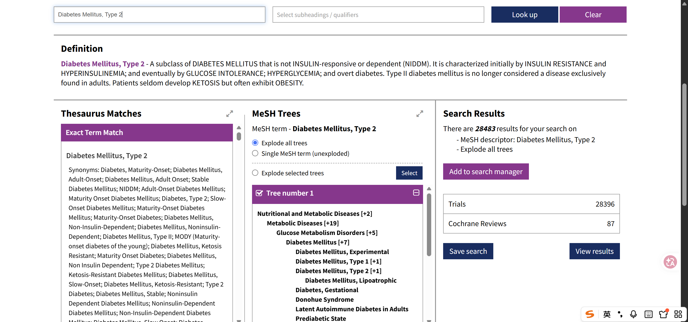
#2
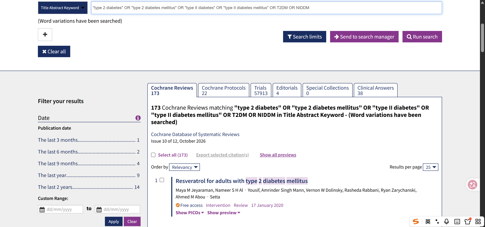
#3
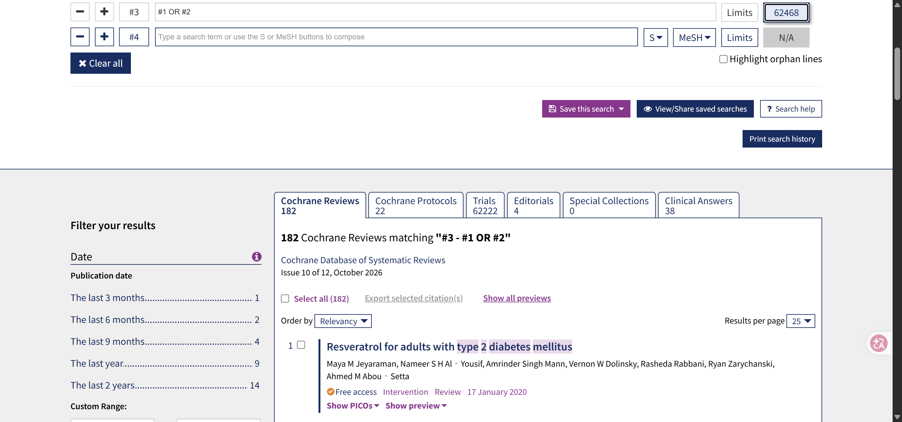
#4
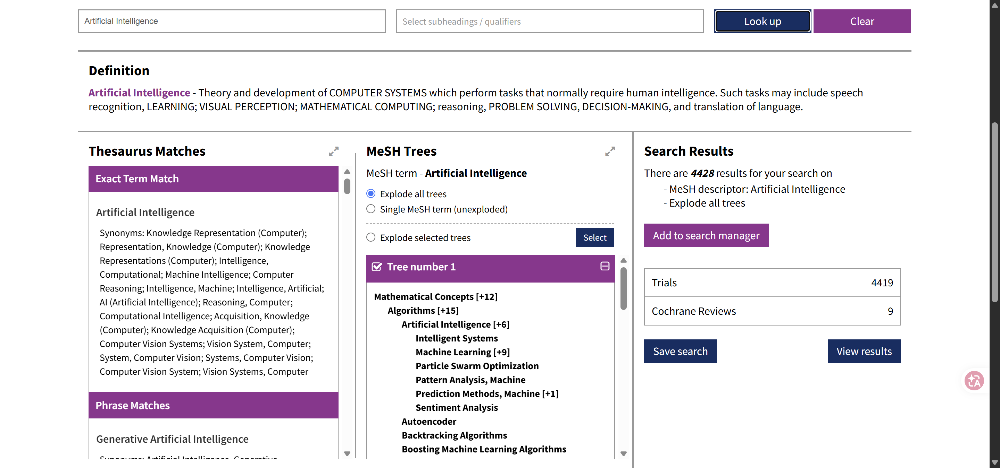
#5
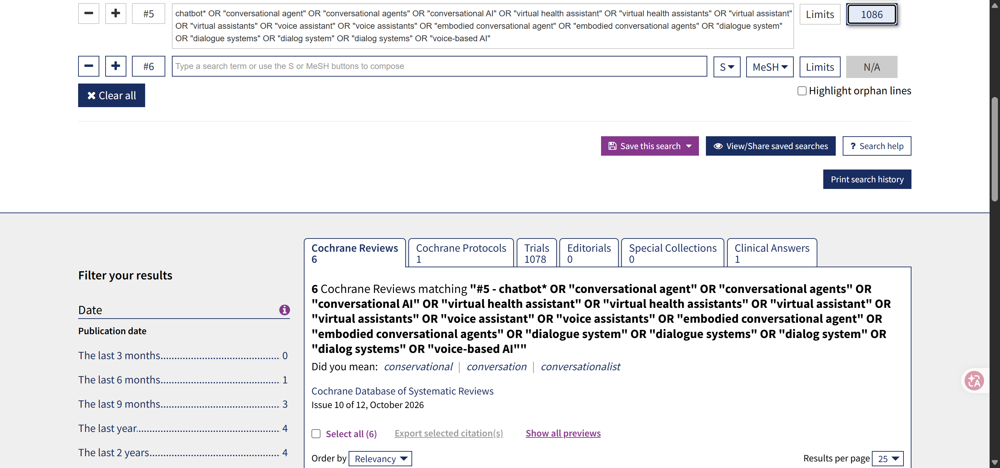
#6
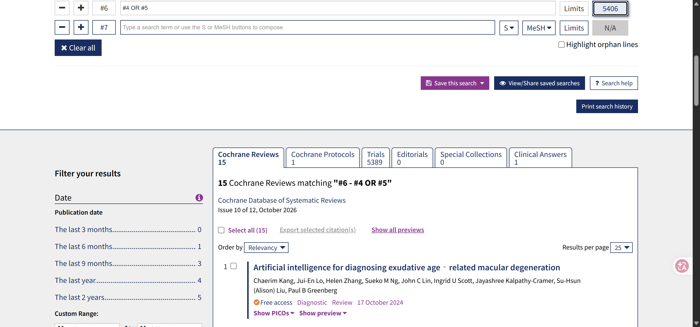
#7
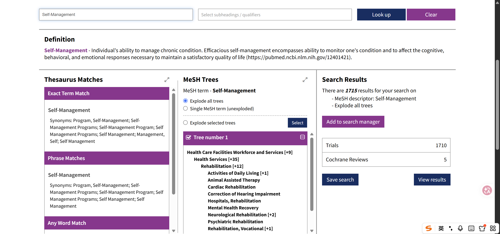
#8
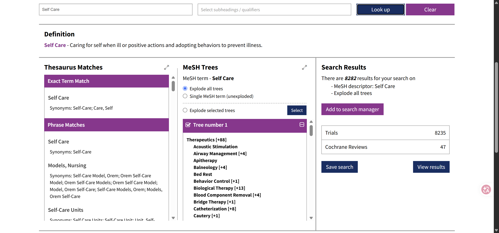
#9
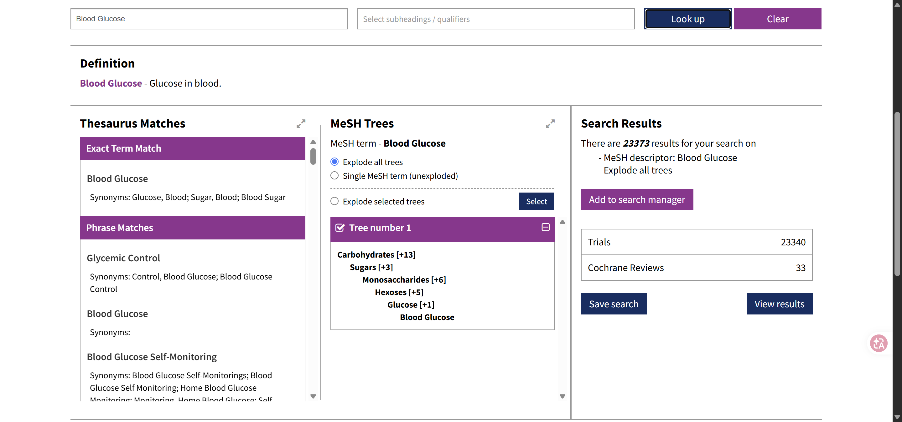
#10
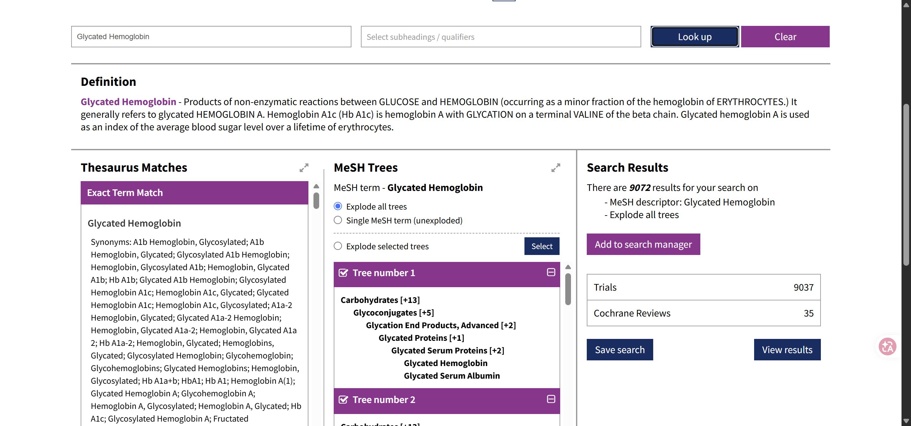
#11
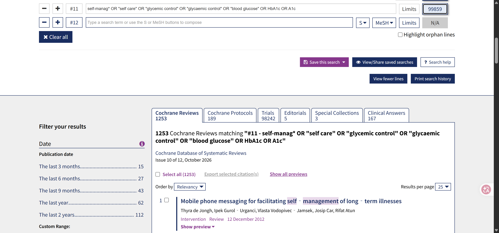
#12
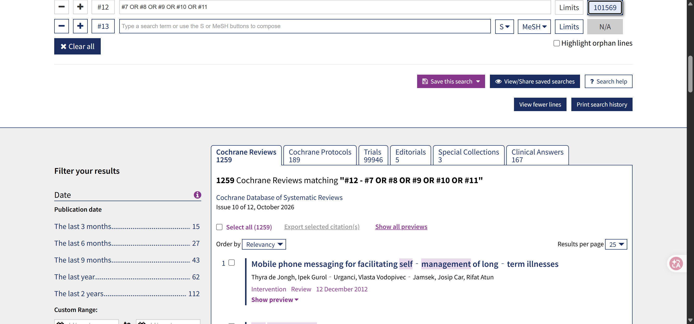
#13
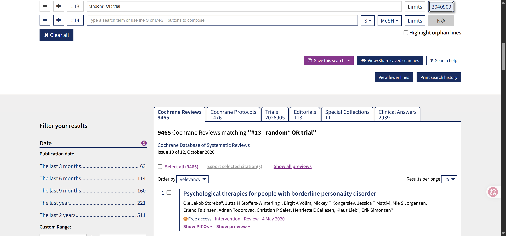
#检索记录：


敏感性检索：

```text
#3 AND #6
```


特异性检索：

```text
#3 AND #5 AND #12 AND #13
```


限制条件：两种检索都将 Content Type 设为 Trials，并记录 CENTRAL 的结果数。不要把 Cochrane Reviews 和 Trials 的数字混在一起。

敏感性检索结果数：【待填写】

敏感性检索潜在相关研究数：【待填写】

特异性检索结果数：【待填写】

特异性检索潜在相关研究数：【待填写】

截图：【待截图。优先截取 Search Manager 的完整编号检索历史和 Trials 结果数】

### 7.3 中国知网（CNKI）

数据库范围：中国知网总库（当前截图中选择的是“总库”）。如果之后改为只检索“学术期刊”或同时检索“学位论文”，必须在敏感性检索和特异性检索中保持范围一致，并在报告中如实写明。

平台：中国知网（CNKI）

实际检索日期：【待填写】

#### 7.3.1 当前页面的正确进入方式

截图中的顶部检索框已经将字段设为“主题”，因此不能再在这个框中输入 `SU=(...)`。`SU=` 是专业检索的字段代码；在已经选择“主题”的普通检索框中再次输入它，系统可能把整段代码当作普通文字，因而出现无结果或无法正常运行。

建议使用下列操作方式：

1. 清除顶部检索框中现有的 `SU=(...)` 内容。
2. 点击页面上方的 **检索 ▼**，进入 **高级检索**。
3. 每个概念组使用一行，字段都选择 **主题**，匹配方式保持 **精确**。
4. 同一行中的同义词使用英文半角加号 `+` 连接，`+` 前后各留一个空格；它表示“或者”。
5. 不同概念组之间选择 **AND**；它表示各组必须同时满足。
6. 本策略已经明确列出中英文同义词，因此先不要启用“同义词扩展”或“中英文扩展”。如果实际启用了任何扩展功能，必须在作业中记录。
7. 暂时不限制发表年份、核心期刊或基金文献。保持数据库范围为“总库”，或者选择教师指定的数据库范围，并在两种检索中保持一致。

注意：下面各行只复制“输入”后面的关键词，不要把“第1行”“主题”“AND”等说明文字一起复制到检索框。

#### 7.3.2 敏感性检索：详细操作

第1行：字段选择 **主题**，匹配方式选择 **精确**，输入：

```text
2型糖尿病 + 二型糖尿病 + Ⅱ型糖尿病 + II型糖尿病 + T2DM + NIDDM + 非胰岛素依赖型糖尿病
```

点击加号增加第2行；第2行左侧逻辑关系选择 **AND**，字段选择 **主题**，匹配方式选择 **精确**，输入：

```text
人工智能 + 对话式人工智能 + 对话代理 + 对话系统 + 聊天机器人 + 虚拟健康助手 + 语音助手 + 人机对话 + ChatGPT + chatbot + 'conversational agent'
```

检查页面应当表达以下逻辑，然后点击 **检索**：

```text
主题=(2型糖尿病相关词) AND 主题=(人工智能或对话系统相关词)
```

检索完成后，记录结果数并保存截图。截图应同时显示“总库”或实际数据库范围、两行主题检索条件、行间的 AND、所用限制条件和结果数量。

中文检索结果：

外文检索结果：


#### 7.3.3 特异性检索：详细操作

点击 **重置条件**，然后建立4行主题检索条件。

第1行：字段选择 **主题**，匹配方式选择 **精确**，输入与敏感性检索相同的糖尿病词组：

```text
2型糖尿病 + 二型糖尿病 + Ⅱ型糖尿病 + II型糖尿病 + T2DM + NIDDM + 非胰岛素依赖型糖尿病
```

第2行：左侧选择 **AND**，字段选择 **主题**，匹配方式选择 **精确**，输入较具体的对话型人工智能词组：

```text
对话式人工智能 + 对话代理 + 会话代理 + 对话系统 + 聊天机器人 + 虚拟健康助手 + 语音助手 + 人机对话 + ChatGPT + chatbot + 'conversational agent'
```

第3行：左侧选择 **AND**，字段选择 **主题**，匹配方式选择 **精确**，输入自我管理和血糖控制词组：

```text
自我管理 + 自我护理 + 自我照护 + 糖尿病教育 + 健康教育 + 行为支持 + 血糖管理 + 血糖控制 + 血糖监测 + 糖化血红蛋白 + HbA1c + 用药依从性 + 服药依从性
```

第4行：左侧选择 **AND**，字段选择 **主题**，匹配方式选择 **精确**，输入研究设计词组：

```text
随机对照试验 + 随机对照研究 + 随机分组 + 随机 + 对照试验 + 临床试验 + 干预研究 + RCT
```

检查页面应当表达以下逻辑，然后点击 **检索**：

```text
主题=(2型糖尿病相关词)
AND 主题=(对话型人工智能相关词)
AND 主题=(自我管理或血糖控制相关词)
AND 主题=(随机或临床试验相关词)
```

限制条件：敏感性检索和特异性检索均暂不限制发表年份。不要额外勾选核心期刊、CSSCI、基金文献等来源限制，除非教师明确要求。若使用了数据库范围、语言、时间、来源类型或扩展功能等任何限制，必须如实记录。

中文检索：

英文检索：


敏感性检索结果数：【待填写】

敏感性检索潜在相关研究数：【待填写】

特异性检索结果数：【待填写】

特异性检索潜在相关研究数：【待填写】

截图：【待截图。截图中应显示数据库范围、检索条件和结果数】

### 7.4 CINAHL

数据库：CINAHL【请确认学校提供的是 CINAHL、CINAHL Plus 还是其他版本】

平台：【待确认，常见为 EBSCOhost】

实际检索日期：【待填写】

说明：先进入 CINAHL Headings 核对主题词。不同订阅版本的主题词显示可能略有区别，如果系统中不存在下列 MH 词，应选择界面推荐的最接近主题词，并保存主题词页面截图。

没有该数据库的账号权限：


建议在 Advanced Search 的 Search History 中分组运行：

```text
S1 (MH "Diabetes Mellitus, Type 2+") OR TI ("type 2 diabetes" OR "type 2 diabetes mellitus" OR "type II diabetes" OR "type II diabetes mellitus" OR T2DM OR NIDDM) OR AB ("type 2 diabetes" OR "type 2 diabetes mellitus" OR "type II diabetes" OR "type II diabetes mellitus" OR T2DM OR NIDDM)

S2 (MH "Artificial Intelligence+") OR (MH "Natural Language Processing") OR TI (chatbot* OR "conversational agent*" OR "conversational AI" OR "virtual health assistant*" OR "virtual assistant*" OR "voice assistant*" OR "embodied conversational agent*" OR "dialogue system*" OR "dialog system*" OR "voice-based AI") OR AB (chatbot* OR "conversational agent*" OR "conversational AI" OR "virtual health assistant*" OR "virtual assistant*" OR "voice assistant*" OR "embodied conversational agent*" OR "dialogue system*" OR "dialog system*" OR "voice-based AI")

S3 TI (chatbot* OR "conversational agent*" OR "conversational AI" OR "virtual health assistant*" OR "virtual assistant*" OR "voice assistant*" OR "embodied conversational agent*" OR "dialogue system*" OR "dialog system*" OR "voice-based AI") OR AB (chatbot* OR "conversational agent*" OR "conversational AI" OR "virtual health assistant*" OR "virtual assistant*" OR "voice assistant*" OR "embodied conversational agent*" OR "dialogue system*" OR "dialog system*" OR "voice-based AI")

S4 TI (self-manag* OR "self care" OR "glycemic control" OR "glycaemic control" OR "blood glucose" OR HbA1c OR A1c) OR AB (self-manag* OR "self care" OR "glycemic control" OR "glycaemic control" OR "blood glucose" OR HbA1c OR A1c)

S5 (PT "Randomized Controlled Trial") OR TI (random* OR trial) OR AB (random* OR trial)
```

敏感性检索：

```text
S1 AND S2
```

特异性检索：

```text
S1 AND S3 AND S4 AND S5
```

限制条件：特异性检索可在 Limiters 中选择 Human 和 All Adult；不限制发表年份和语言。若界面没有 PT "Randomized Controlled Trial"，删除该部分，改用 Publication Type 限制器或系统提供的随机对照试验主题词，同时保留题名/摘要中的 random* OR trial。

敏感性检索结果数：【待填写】

敏感性检索潜在相关研究数：【待填写】

特异性检索结果数：【待填写】

特异性检索潜在相关研究数：【待填写】

截图：【待截图。建议截取 Search History，使 S1-S5、组合方式和结果数同时可见】

### 7.5 Web of Science Core Collection

数据库：Web of Science Core Collection

平台：Web of Science（Clarivate）

实际检索日期：【待填写】

#### 7.5.1 当前截图所示页面及访问要求

没有该数据库的账号权限：


当前截图属于 Web of Science 平台，但尚不是用于本作业的 Web of Science Core Collection 文献主题检索页面。截图中的检索类型为 **Name Search**，输入框要求填写 **Last Name** 和 **First Name**，用于按研究者姓名查找研究者档案或作者记录；不能把本作业的主题关键词输入这些姓名框中。页面也没有显示数据库名称 **Web of Science Core Collection**、字段 **Topic** 或可输入 `TS=` 检索式的 Advanced Search 查询框。

这通常表示当前仅登录了个人 Web of Science 账户，但尚未通过学校或其他订阅机构取得 Core Collection 的文献检索权限。个人账户可以建立研究者档案，但不能代替机构订阅。必须先从学校图书馆数据库入口进入 Web of Science，或在 Web of Science 中选择 **Institutional Sign In**，通过学校统一身份认证、VPN、CARSI、Shibboleth、OpenAthens 或图书馆校外访问系统完成授权。

获得授权后，页面应至少能够显示以下内容：

- 检索对象为 **Documents** 或 **Document Search**，而不是 Researchers/Name Search；
- 数据库选择器显示 **Web of Science Core Collection**；
- 普通检索页面能够选择字段 **Topic**；或者 Advanced Search 页面允许输入以 `TS=` 开头的检索式；
- 能够选择 Timespan、查看检索结果数和 Search History。

如果仍然只能看到 Name Search、Last Name 和 First Name，不要继续输入本作业的关键词，应联系学校图书馆或任课教师解决数据库访问权限。

#### 7.5.2 进入正确检索页面

1. 从学校图书馆的数据库导航进入 **Web of Science**，或访问 `https://www.webofscience.com/` 后选择 **Institutional Sign In** 并完成学校身份认证。
2. 登录后点击顶部 **Search**，选择 **Documents** 或 **Document Search**。
3. 在数据库选择器中选择 **Web of Science Core Collection**。不要选择 Researchers、Researcher Search，也不要把 All Databases 的结果当作 Core Collection 的结果。
4. 打开 **Advanced Search**。本节优先使用 Advanced Search，因为它可以直接输入完整的 `TS=` 检索式，也便于在 Search History 中保存完整策略。
5. 将 **Timespan** 设为 **All years** 或系统提供的最完整年份范围；Core Collection 内的引文索引保持机构默认的全部可用索引。
6. 敏感性检索和特异性检索均不限制语言、国家、开放获取状态和文献类型。除非教师明确要求，不要预先勾选 Article、Open Access 等筛选条件。

`TS` 代表 **Topic**，检索题名、摘要、作者关键词和 Keywords Plus。英文短语使用英文双引号，`OR` 连接同义词，`AND` 连接不同概念，星号 `*` 用于检索词尾变化。

#### 7.5.3 敏感性检索：详细操作

在 **Advanced Search** 的查询框中完整输入以下检索式：

```text
TS=("type 2 diabetes" OR "type 2 diabetes mellitus" OR "type II diabetes" OR "type II diabetes mellitus" OR T2DM OR NIDDM)
AND
TS=("artificial intelligence" OR chatbot* OR "conversational agent*" OR "conversational AI" OR "virtual health assistant*" OR "virtual assistant*" OR "voice assistant*" OR "embodied conversational agent*" OR "dialogue system*" OR "dialog system*" OR "voice-based AI" OR ChatGPT OR "large language model*")
```

检查括号和双引号后点击 **Search**。进入结果页后：

1. 确认页面显示的数据库是 Web of Science Core Collection，而不是 All Databases。
2. 不要在结果页追加筛选条件；记录页面显示的总结果数。
3. 打开 **Search History**，确认本次检索被保存为一个检索集合，并保存能够显示完整检索式和结果数的截图。
4. 阅读题名和摘要，按第 8 节标准记录“潜在相关研究数”。

如果获得授权后的页面只有逐行的 Document Search，没有可输入 `TS=` 的 Advanced Search 查询框，则使用以下等价操作：

1. 第1行字段选择 **Topic**，输入糖尿病词组（只输入 `TS=(...)` 括号内的内容，不要输入 `TS=`）。
2. 点击 **Add row**；行间关系选择 **AND**。
3. 第2行字段选择 **Topic**，输入人工智能和对话代理词组（同样只输入第二个 `TS=(...)` 括号内的内容）。
4. 点击 **Search**，记录结果数并保存 Search History 截图。

#### 7.5.4 特异性检索：详细操作

返回 **Advanced Search**，清除上一条检索式，再完整输入：

```text
TS=("type 2 diabetes" OR "type 2 diabetes mellitus" OR "type II diabetes" OR "type II diabetes mellitus" OR T2DM OR NIDDM)
AND
TS=(chatbot* OR "conversational agent*" OR "conversational AI" OR "virtual health assistant*" OR "virtual assistant*" OR "voice assistant*" OR "embodied conversational agent*" OR "dialogue system*" OR "dialog system*" OR "voice-based AI" OR ChatGPT OR "large language model*")
AND
TS=(self-manag* OR "self care" OR "glycemic control" OR "glycaemic control" OR "blood glucose" OR HbA1c OR A1c)
AND
TS=(random* OR trial)
```

点击 **Search** 后，确认数据库范围和限制条件与敏感性检索完全一致，记录结果总数，并在 Search History 中保存包含完整检索式和结果数的截图。随后阅读题名和摘要，填写潜在相关研究数。

如果只能使用逐行的 Document Search，则建立4行 **Topic** 条件：第1行为糖尿病词组，第2行为对话型人工智能词组，第3行为自我管理和血糖控制词组，第4行为随机试验词组；各行之间均选择 **AND**。不要把 `TS=` 复制到已经选择 Topic 的普通输入框中。

#### 7.5.5 记录和截图要求

敏感性检索与特异性检索必须使用相同的数据库、Timespan、引文索引和其他限制条件。每组检索至少保存：

1. 显示 **Web of Science Core Collection** 数据库名称的页面；
2. 显示完整检索式及结果数的 Search History 页面；
3. 如使用了任何年份、文献类型、语言或开放获取筛选，显示这些筛选条件的结果页面。

当前 Name Search 页面只能作为“尚未取得 Core Collection 文献检索权限”的记录，不能作为本作业的 Web of Science 检索截图。

敏感性检索结果数：【待取得机构授权并实际检索后填写】

敏感性检索潜在相关研究数：【待取得机构授权并完成题名/摘要初筛后填写】

特异性检索结果数：【待取得机构授权并实际检索后填写】

特异性检索潜在相关研究数：【待取得机构授权并完成题名/摘要初筛后填写】

截图：【待取得机构授权后补充。需显示数据库名称、完整检索式、结果数和筛选条件】

## 8. 潜在相关研究的初筛方法

对每个数据库的检索结果阅读题名和摘要。满足以下条件时，暂时记为“潜在相关”：

1. 研究对象包含成年 2 型糖尿病患者。
2. 干预是能够与患者进行自动对话的人工智能工具，而不是只用于预测、诊断或影像识别的普通 AI 模型。
3. 干预涉及糖尿病自我管理、教育、行为支持、用药管理或血糖控制。
4. 研究是随机对照试验，或摘要显示使用了随机分组。

以下文献一般不计入最终潜在相关研究：综述、社论、单纯质性研究、无随机分组的观察性研究、仅描述系统设计的论文、只有研究方案而没有试验结果的 protocol，以及无法单独提取 2 型糖尿病成人数据的混合人群研究。

计数时先记录每个数据库自身的潜在相关数量，不要先跨数据库去重。如果另外报告五个数据库合并后的唯一文献数，应明确说明已经去重。

## 9. 检索结果描述模板

【完成实际检索后，将方括号内容替换为真实数字。】

本研究于【检索日期】在 PubMed、Cochrane Library、CNKI、CINAHL 和 Web of Science Core Collection 中进行了检索。敏感性检索主要组合 2 型糖尿病与人工智能对话代理相关词汇，以尽可能提高查全率；特异性检索进一步加入自我管理或血糖控制结局以及随机试验相关词汇，以减少无关结果。

敏感性检索在五个数据库中分别获得 PubMed【】条、Cochrane CENTRAL【】条、CNKI【】条、CINAHL【】条和 Web of Science Core Collection【】条。经题名和摘要初筛，分别有【】、【】、【】、【】和【】条被认为可能相关。

特异性检索分别获得 PubMed【】条、Cochrane CENTRAL【】条、CNKI【】条、CINAHL【】条和 Web of Science Core Collection【】条。经初筛，分别有【】、【】、【】、【】和【】条被认为可能相关。

与特异性检索相比，敏感性检索获得的结果更多，但其中可能包含将人工智能用于风险预测、诊断或数据分析而不是患者对话支持的研究。特异性检索通过加入对话代理、结局和随机试验词减少了无关结果，但也可能遗漏摘要未明确报告这些信息或尚未完成主题标引的新文献。因此，最终检索策略应结合受控词表和自由文本词，并同时报告敏感性与特异性检索结果。

## 10. 截图和记录指引

每个数据库至少保留敏感性检索和特异性检索两组证据。若完整检索式无法在一张截图中显示，可以使用“检索历史截图 + 结果页面截图”。

建议截图文件依次命名为：

- 01_PubMed_sensitive
- 02_PubMed_specific
- 03_Cochrane_sensitive
- 04_Cochrane_specific
- 05_CNKI_sensitive
- 06_CNKI_specific
- 07_CINAHL_sensitive
- 08_CINAHL_specific
- 09_WoS_sensitive
- 10_WoS_specific

每组截图应尽可能显示数据库或平台名称、检索日期、完整检索式或检索历史、使用的限制条件和结果数。截完图后立即把页面上的数字填入本稿，避免数据库更新后数字发生变化。

## 11. 你必须亲自完成的内容

1. 确认教师要求的提交语言、篇幅和文件格式，因为原稿没有写明。
2. 登录学校图书馆提供的 CNKI、CINAHL、Cochrane Library 和 Web of Science 入口。
3. 在五个数据库中实际运行两种检索，并记录真实平台名称、日期、限制条件和结果数。
4. 保存完整截图。
5. 阅读题名和摘要，填写“潜在相关研究数”。
6. 检查 CINAHL Headings 和 CNKI 当前界面的字段语法，并按实际界面修正检索式。
7. 用真实数字完成“检索结果描述”。
8. 删除所有“【待填写】”“【待截图】”和使用说明。
9. 按学校要求填写并签署生成式 AI 使用声明。

## 12. 检索策略开发依据

- PubMed Help: https://pubmed.ncbi.nlm.nih.gov/help/
- NLM MeSH Browser: https://meshb.nlm.nih.gov/
- EBSCOhost Searching Tips: https://connect.ebsco.com/s/article/EBSCOhost-Searching-Tips?language=en_US
- Web of Science Core Collection Search Fields: https://webofscience.help.clarivate.com/en-us/Content/wos-core-collection/woscc-search-fields.htm

这些帮助页面用于核对字段标签、主题词、布尔运算符和平台语法。最终提交时是否保留本节，可根据教师规定决定。
