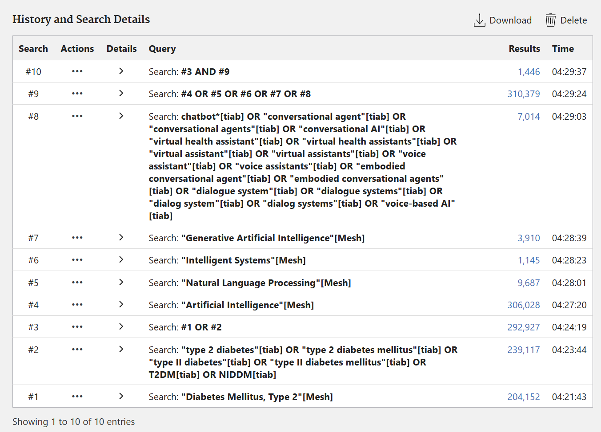
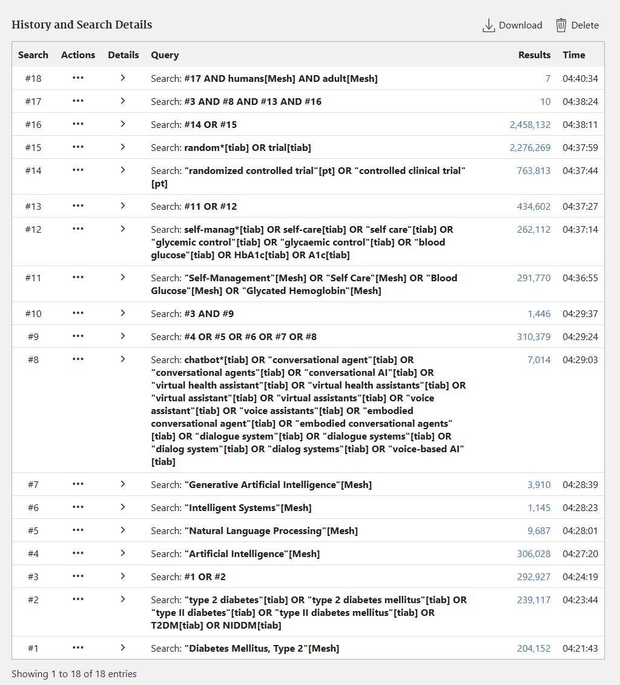
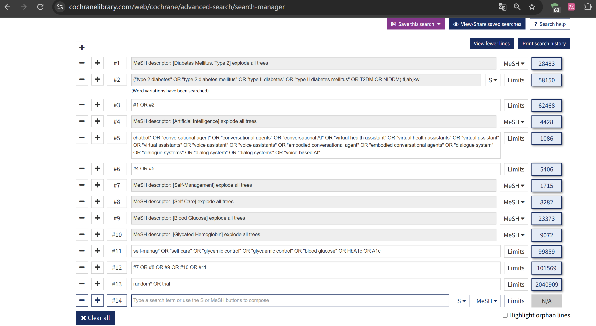
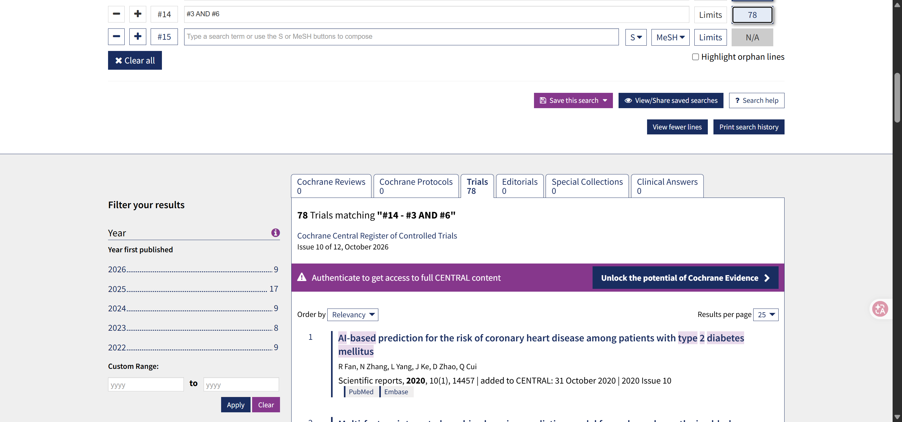
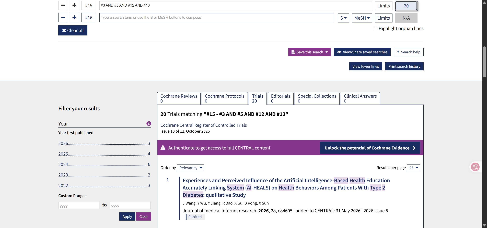

# 作业一：基于 PICOS 的多数据库文献检索策略

学号：p2625633
姓名：何宁秋

## 1. 作业题目

**中文题目：** 人工智能驱动的对话代理在支持 2 型糖尿病成人患者自我管理和改善血糖控制方面的有效性：针对随机对照试验的多数据库检索

**英文题目：** The Effectiveness of Artificial Intelligence-Powered Conversational Agents in Supporting Self-Management and Improving Glycemic Control Among Adults With Type 2 Diabetes: A Multi-Database Search for Randomized Controlled Trials

## 2. 背景与目的

2 型糖尿病的管理涉及血糖监测、用药、饮食和身体活动等多方面内容。护理人员通常参与患者教育、行为支持和随访。聊天机器人、虚拟健康助手和语音助手等对话式人工智能工具，可以在日常生活中向患者提供教育、提醒和反馈，但其对自我管理和血糖控制的实际效果仍需通过临床研究评价。

本报告依据 PICOS 框架拆分研究问题，并针对 PubMed、Cochrane Library、CNKI、CINAHL 和 Web of Science Core Collection 制定敏感性与特异性检索策略。报告内容包括检索词、数据库适配方法、限制条件、实际结果和访问限制。

## 3. 临床护理问题

对于成年 2 型糖尿病患者，与常规护理、常规糖尿病教育或未使用人工智能对话工具相比，使用人工智能驱动的对话代理是否能够改善患者的自我管理和血糖控制？

## 4. PICOS 框架

| PICOS 要素 | 定义 | 纳入范围 |
|---|---|---|
| P：研究对象 | 成年 2 型糖尿病患者 | 研究所定义的成年人，且被诊断为 2 型糖尿病；混合人群研究须能够单独提取成年 2 型糖尿病患者数据 |
| I：干预措施 | 人工智能驱动的对话代理 | 聊天机器人、虚拟健康助手、具身对话代理、语音助手及其他能够与患者自动对话的人工智能系统 |
| C：比较措施 | 常规护理或非对话式干预 | 常规护理、常规糖尿病教育、等待名单、未使用人工智能对话工具，或其他非对话式数字健康干预 |
| O：结局指标 | 自我管理与血糖控制 | 血糖监测、合理用药、饮食和身体活动管理、HbA1c、血糖水平、服药依从性和自我效能 |
| S：研究设计 | 随机对照试验 | 已发表的随机对照试验；仅有研究方案（protocol）而没有试验结果的文献不作为最终有效性证据 |

比较措施没有纳入敏感性检索式。不同研究对对照条件的表述差异较大，加入这一概念可能造成漏检。

## 5. 检索概念与检索词

| 概念 | 受控词 | 英文自由词 | 中文自由词 |
|---|---|---|---|
| 2 型糖尿病 | Diabetes Mellitus, Type 2 | type 2 diabetes; type 2 diabetes mellitus; type II diabetes; type II diabetes mellitus; T2DM; NIDDM | 2型糖尿病；二型糖尿病；Ⅱ型糖尿病；II型糖尿病；T2DM；NIDDM；非胰岛素依赖型糖尿病 |
| 人工智能对话代理 | Artificial Intelligence; Natural Language Processing; Intelligent Systems; Generative Artificial Intelligence | chatbot*; conversational agent*; conversational AI; virtual health assistant*; virtual assistant*; voice assistant*; embodied conversational agent*; dialogue system*; dialog system*; voice-based AI; ChatGPT | 人工智能；对话式人工智能；对话代理；会话代理；对话系统；聊天机器人；虚拟健康助手；语音助手；人机对话；ChatGPT |
| 自我管理与血糖控制 | Self-Management; Self Care; Blood Glucose; Glycated Hemoglobin | self-manag*; self care; glycemic control; glycaemic control; blood glucose; HbA1c; A1c | 自我管理；自我护理；自我照护；糖尿病教育；健康教育；行为支持；血糖管理；血糖控制；血糖监测；糖化血红蛋白；HbA1c；用药依从性 |
| 随机试验 | Randomized Controlled Trial; Controlled Clinical Trial | random*; trial | 随机对照试验；随机对照研究；随机分组；随机；对照试验；临床试验；干预研究；RCT |

敏感性检索仅组合研究对象和干预概念；特异性检索进一步加入自我管理或血糖控制结局以及随机试验词。前者侧重查全，后者侧重减少无关结果。

## 6. 数据库检索策略与结果

检索及数据库访问日期为 **2026 年 10 月 16 日**。除另有说明外，检索不限制发表年份和语言。

### 6.1 PubMed

**数据库与平台：** PubMed，U.S. National Library of Medicine（NLM）  
**限制条件：** 敏感性检索不设限制；特异性检索最终限定 Humans 和 Adult: 19+；不限制年份和语言。

#### 6.1.1 敏感性检索

在 Advanced Search 的 History 中建立以下集合：

```text
#1 "Diabetes Mellitus, Type 2"[Mesh]

#2 "type 2 diabetes"[tiab] OR "type 2 diabetes mellitus"[tiab]
   OR "type II diabetes"[tiab] OR "type II diabetes mellitus"[tiab]
   OR T2DM[tiab] OR NIDDM[tiab]

#3 #1 OR #2

#4 "Artificial Intelligence"[Mesh]
#5 "Natural Language Processing"[Mesh]
#6 "Intelligent Systems"[Mesh]
#7 "Generative Artificial Intelligence"[Mesh]

#8 chatbot*[tiab] OR "conversational agent"[tiab]
   OR "conversational agents"[tiab] OR "conversational AI"[tiab]
   OR "virtual health assistant"[tiab] OR "virtual health assistants"[tiab]
   OR "virtual assistant"[tiab] OR "virtual assistants"[tiab]
   OR "voice assistant"[tiab] OR "voice assistants"[tiab]
   OR "embodied conversational agent"[tiab]
   OR "embodied conversational agents"[tiab]
   OR "dialogue system"[tiab] OR "dialogue systems"[tiab]
   OR "dialog system"[tiab] OR "dialog systems"[tiab]
   OR "voice-based AI"[tiab]

#9 #4 OR #5 OR #6 OR #7 OR #8

#10 #3 AND #9
```

#10 为敏感性检索，共获得 **1,446 条**结果。



*图 1. PubMed 敏感性检索历史；#10 显示 1,446 条结果。*

#### 6.1.2 特异性检索

在同一 History 中继续建立结局和随机试验集合：

```text
#11 "Self-Management"[Mesh] OR "Self Care"[Mesh]
    OR "Blood Glucose"[Mesh] OR "Glycated Hemoglobin"[Mesh]

#12 self-manag*[tiab] OR self-care[tiab] OR "self care"[tiab]
    OR "glycemic control"[tiab] OR "glycaemic control"[tiab]
    OR "blood glucose"[tiab] OR HbA1c[tiab] OR A1c[tiab]

#13 #11 OR #12

#14 "randomized controlled trial"[pt] OR "controlled clinical trial"[pt]

#15 random*[tiab] OR trial[tiab]

#16 #14 OR #15

#17 #3 AND #8 AND #13 AND #16

#18 #17 AND humans[Mesh] AND adult[Mesh]
```

#18 为特异性检索，共获得 **7 条**结果。



*图 2. PubMed 特异性检索历史；#18 显示 7 条结果。*

### 6.2 Cochrane Library

**数据库：** Cochrane Central Register of Controlled Trials（CENTRAL）  
**平台：** Cochrane Library  
**限制条件：** Content Type 选择 Trials；不限制年份和语言。

在 Advanced Search 的 Search Manager 中建立以下检索集合。MeSH 词使用 Exact Term Match，并选择 Explode all trees；自由词限定在 Title、Abstract 和 Keyword 字段。

```text
#1 MeSH descriptor: [Diabetes Mellitus, Type 2] explode all trees

#2 ("type 2 diabetes" OR "type 2 diabetes mellitus" OR "type II diabetes"
   OR "type II diabetes mellitus" OR T2DM OR NIDDM):ti,ab,kw

#3 #1 OR #2

#4 MeSH descriptor: [Artificial Intelligence] explode all trees

#5 (chatbot* OR "conversational agent" OR "conversational agents"
   OR "conversational AI" OR "virtual health assistant"
   OR "virtual health assistants" OR "virtual assistant" OR "virtual assistants"
   OR "voice assistant" OR "voice assistants"
   OR "embodied conversational agent" OR "embodied conversational agents"
   OR "dialogue system" OR "dialogue systems" OR "dialog system"
   OR "dialog systems" OR "voice-based AI"):ti,ab,kw

#6 #4 OR #5

#7 MeSH descriptor: [Self-Management] explode all trees
#8 MeSH descriptor: [Self Care] explode all trees
#9 MeSH descriptor: [Blood Glucose] explode all trees
#10 MeSH descriptor: [Glycated Hemoglobin] explode all trees

#11 (self-manag* OR "self care" OR "glycemic control" OR "glycaemic control"
    OR "blood glucose" OR HbA1c OR A1c):ti,ab,kw

#12 #7 OR #8 OR #9 OR #10 OR #11

#13 (random* OR trial):ti,ab,kw
```



*图 3. Cochrane Search Manager 中的 #1-#13 检索历史。*

#### 6.2.1 敏感性检索

```text
#3 AND #6
```

在 Trials 中获得 **78 条**结果。



*图 4. Cochrane CENTRAL 敏感性检索获得 78 条 Trials。*

#### 6.2.2 特异性检索

```text
#3 AND #5 AND #12 AND #13
```

在 Trials 中获得 **20 条**结果。



*图 5. Cochrane CENTRAL 特异性检索获得 20 条 Trials。*

### 6.3 中国知网（CNKI）

**数据库与平台：** 中国知网总库，中文文献  
**检索字段：** 主题  
**匹配方式：** 精确  
**限制条件：** 不限制年份；未勾选 OA 出版、网络首发、增强出版或基金文献；未启用中英文扩展和同义词扩展。

CNKI 同一概念组内的同义词以半角加号 `+` 连接，不同概念组以 `AND` 连接。本报告以中文文献作为 CNKI 的主要结果，外文文献检索作为补充记录。

#### 6.3.1 敏感性检索

第1行，主题：

```text
2型糖尿病 + 二型糖尿病 + Ⅱ型糖尿病 + II型糖尿病 + T2DM + NIDDM + 非胰岛素依赖型糖尿病
```

第2行，AND 主题：

```text
人工智能 + 对话式人工智能 + 对话代理 + 对话系统 + 聊天机器人 + 虚拟健康助手 + 语音助手 + 人机对话 + ChatGPT + chatbot + 'conversational agent'
```

中文总库获得 **142 条**结果。


*图 6. CNKI 中文总库敏感性检索获得 142 条结果。*

同一检索式在外文文献中获得 **155 条**结果。该部分仅作补充记录，不与 CNKI 中文结果合并计算。


*图 7. CNKI 外文文献补充检索获得 155 条结果。*

#### 6.3.2 特异性检索

第1行，主题：

```text
2型糖尿病 + 二型糖尿病 + Ⅱ型糖尿病 + II型糖尿病 + T2DM + NIDDM + 非胰岛素依赖型糖尿病
```

第2行，AND 主题：

```text
对话式人工智能 + 对话代理 + 会话代理 + 对话系统 + 聊天机器人 + 虚拟健康助手 + 语音助手 + 人机对话 + ChatGPT + chatbot + 'conversational agent'
```

第3行，AND 主题：

```text
自我管理 + 自我护理 + 自我照护 + 糖尿病教育 + 健康教育 + 行为支持 + 血糖管理 + 血糖控制 + 血糖监测 + 糖化血红蛋白 + HbA1c + 用药依从性 + 服药依从性
```

第4行，AND 主题：

```text
随机对照试验 + 随机对照研究 + 随机分组 + 随机 + 对照试验 + 临床试验 + 干预研究 + RCT
```

中文总库获得 **1 条**结果。


*图 8. CNKI 中文总库特异性检索获得 1 条结果。*

外文文献检索获得 **1 条**结果。截图显示该次检索启用了中英文扩展，与中文检索的设置不同，因此只作为补充材料，不纳入主要结果比较。


*图 9. CNKI 外文文献补充检索获得 1 条结果。*

### 6.4 CINAHL

**数据库与平台：** CINAHL，EBSCOhost（订阅版本未能确认）  
**访问情况：** 通过学校机构入口登录时，系统未能识别当前账号组合，因而无法进入 CINAHL 检索页面。本节保留拟定策略和登录失败截图，用于说明未取得结果数的原因。

拟在 Advanced Search 的 Search History 中建立以下集合：

```text
S1 (MH "Diabetes Mellitus, Type 2+")
   OR TI ("type 2 diabetes" OR "type 2 diabetes mellitus" OR "type II diabetes"
          OR "type II diabetes mellitus" OR T2DM OR NIDDM)
   OR AB ("type 2 diabetes" OR "type 2 diabetes mellitus" OR "type II diabetes"
          OR "type II diabetes mellitus" OR T2DM OR NIDDM)

S2 (MH "Artificial Intelligence+") OR (MH "Natural Language Processing")
   OR TI (chatbot* OR "conversational agent*" OR "conversational AI"
          OR "virtual health assistant*" OR "virtual assistant*" OR "voice assistant*"
          OR "embodied conversational agent*" OR "dialogue system*"
          OR "dialog system*" OR "voice-based AI")
   OR AB (chatbot* OR "conversational agent*" OR "conversational AI"
          OR "virtual health assistant*" OR "virtual assistant*" OR "voice assistant*"
          OR "embodied conversational agent*" OR "dialogue system*"
          OR "dialog system*" OR "voice-based AI")

S3 TI (chatbot* OR "conversational agent*" OR "conversational AI"
       OR "virtual health assistant*" OR "virtual assistant*" OR "voice assistant*"
       OR "embodied conversational agent*" OR "dialogue system*"
       OR "dialog system*" OR "voice-based AI")
   OR AB (chatbot* OR "conversational agent*" OR "conversational AI"
       OR "virtual health assistant*" OR "virtual assistant*" OR "voice assistant*"
       OR "embodied conversational agent*" OR "dialogue system*"
       OR "dialog system*" OR "voice-based AI")

S4 TI (self-manag* OR "self care" OR "glycemic control" OR "glycaemic control"
       OR "blood glucose" OR HbA1c OR A1c)
   OR AB (self-manag* OR "self care" OR "glycemic control" OR "glycaemic control"
       OR "blood glucose" OR HbA1c OR A1c)

S5 (PT "Randomized Controlled Trial") OR TI (random* OR trial)
   OR AB (random* OR trial)
```

敏感性组合为 `S1 AND S2`，特异性组合为 `S1 AND S3 AND S4 AND S5`。由于未进入数据库，上述主题词和字段代码尚未在学校订阅版本中核对，本次不报告 CINAHL 结果数。


*图 10. CINAHL 机构登录失败页面。该截图用于说明未能完成实际检索的原因。*

### 6.5 Web of Science Core Collection

**数据库：** Web of Science Core Collection  
**平台：** Web of Science（Clarivate）  
**访问情况：** 登录个人账户后，页面仅提供 Name Search，没有显示 Core Collection 数据库选择器、Topic 字段或 Advanced Search 查询框。本节保留拟定策略和当前页面截图，用于说明未取得 Document Search 权限。

拟定的敏感性检索式为：

```text
TS=("type 2 diabetes" OR "type 2 diabetes mellitus" OR "type II diabetes"
OR "type II diabetes mellitus" OR T2DM OR NIDDM)
AND
TS=("artificial intelligence" OR chatbot* OR "conversational agent*"
OR "conversational AI" OR "virtual health assistant*" OR "virtual assistant*"
OR "voice assistant*" OR "embodied conversational agent*"
OR "dialogue system*" OR "dialog system*" OR "voice-based AI"
OR ChatGPT OR "large language model*")
```

拟定的特异性检索式为：

```text
TS=("type 2 diabetes" OR "type 2 diabetes mellitus" OR "type II diabetes"
OR "type II diabetes mellitus" OR T2DM OR NIDDM)
AND
TS=(chatbot* OR "conversational agent*" OR "conversational AI"
OR "virtual health assistant*" OR "virtual assistant*" OR "voice assistant*"
OR "embodied conversational agent*" OR "dialogue system*" OR "dialog system*"
OR "voice-based AI" OR ChatGPT OR "large language model*")
AND
TS=(self-manag* OR "self care" OR "glycemic control" OR "glycaemic control"
OR "blood glucose" OR HbA1c OR A1c)
AND
TS=(random* OR trial)
```

`TS` 代表 Topic，检索范围包括题名、摘要、作者关键词和 Keywords Plus。由于未取得 Core Collection 的机构访问权限，上述策略未能实际运行，本次不报告结果数。


*图 11. Web of Science 个人账户页面仅显示 Name Search。该截图用于说明 Core Collection 文献检索权限受限。*

## 7. 检索结果汇总

| 数据库 | 敏感性检索结果 | 特异性检索结果 | 潜在相关研究数 | 状态或说明 |
|---|---:|---:|---|---|
| PubMed | 1,446 | 7 | 尚未筛查 | 已完成实际检索 |
| Cochrane CENTRAL | 78 Trials | 20 Trials | 尚未筛查 | 已完成实际检索；完整 CENTRAL 内容需要认证 |
| CNKI 中文总库 | 142 | 1 | 尚未筛查 | 已完成实际检索；外文检索作为补充材料 |
| CINAHL | — | — | — | 机构登录失败，未进入数据库 |
| Web of Science Core Collection | — | — | — | 未取得 Document Search 权限 |

特异性检索使 PubMed 的结果由 1,446 条降至 7 条，Cochrane CENTRAL 由 78 条降至 20 条，CNKI 中文总库由 142 条降至 1 条。结果数量的明显下降主要来自结局词和随机试验词的加入。这样的策略便于后续筛查，但也可能漏掉摘要未明确报告研究设计或结局的文献。

## 8. 潜在相关研究的初筛标准

题名和摘要初筛采用以下标准：

1. 研究对象包含成年 2 型糖尿病患者；
2. 干预是能够与患者自动对话的人工智能工具，而不是仅用于预测、诊断或影像识别的普通 AI 模型；
3. 干预涉及糖尿病自我管理、教育、行为支持、用药管理或血糖控制；
4. 研究为随机对照试验，或摘要明确报告随机分组。

综述、社论、单纯质性研究、无随机分组的观察性研究、仅描述系统设计的论文、只有研究方案而没有试验结果的 protocol，以及无法单独提取成年 2 型糖尿病患者数据的混合人群研究，不计入最终潜在相关研究数。

题名和摘要筛选尚未完成，因此结果汇总表仅列出数据库返回的记录数，未填写潜在相关研究数。各数据库结果应先分别统计；合并后若报告唯一文献数，还需进行跨数据库去重。

## 9. 方法评价与局限性

敏感性检索包含 Artificial Intelligence 等较宽泛的概念，因而会检出将人工智能用于风险预测、诊断、影像分析或数据建模的文献。特异性检索限定了对话代理、结局和研究设计，结果更集中，但可能遗漏未使用 chatbot 或 conversational agent 等常见表述的早期研究。

本次检索的主要局限是 CINAHL 和 Web of Science Core Collection 的机构访问受限，五个指定数据库中只有三个取得了实际结果。CINAHL 和 Web of Science 的检索式仅为预设方案，未计入结果汇总。CNKI 外文特异性检索启用了中英文扩展，与中文检索设置不一致，也未纳入主要比较。

## 10. 结论

本次检索围绕 2 型糖尿病、人工智能对话代理、自我管理或血糖控制以及随机试验四个概念组展开，并根据不同数据库的字段和受控词表调整检索式。PubMed、Cochrane CENTRAL 和 CNKI 的结果表明，敏感性与特异性策略在结果数量上存在明显差异。研究是否符合纳入条件，仍需结合题名、摘要和全文判断。CINAHL 和 Web of Science Core Collection 因机构访问受限未能完成，这一情况已在报告中保留相应截图证明。

## 11. 生成式人工智能使用说明

生成式人工智能用于协助理解作业要求、整理初步检索词和修改文字表达。数据库操作、截图、结果数及报告内容均由本人进行实际检索贴图及核对。

## 12. 检索策略开发依据

- PubMed Help：https://pubmed.ncbi.nlm.nih.gov/help/
- NLM MeSH Browser：https://meshb.nlm.nih.gov/
- Cochrane Library Advanced Search：https://www.cochranelibrary.com/advanced-search
- 中国知网（CNKI）高级检索：https://www.cnki.net/kns8/AdvSearch
- EBSCOhost Searching Tips：https://connect.ebsco.com/s/article/EBSCOhost-Searching-Tips?language=en_US
- Web of Science Core Collection Search Fields：https://webofscience.help.clarivate.com/en-us/Content/wos-core-collection/woscc-search-fields.htm
